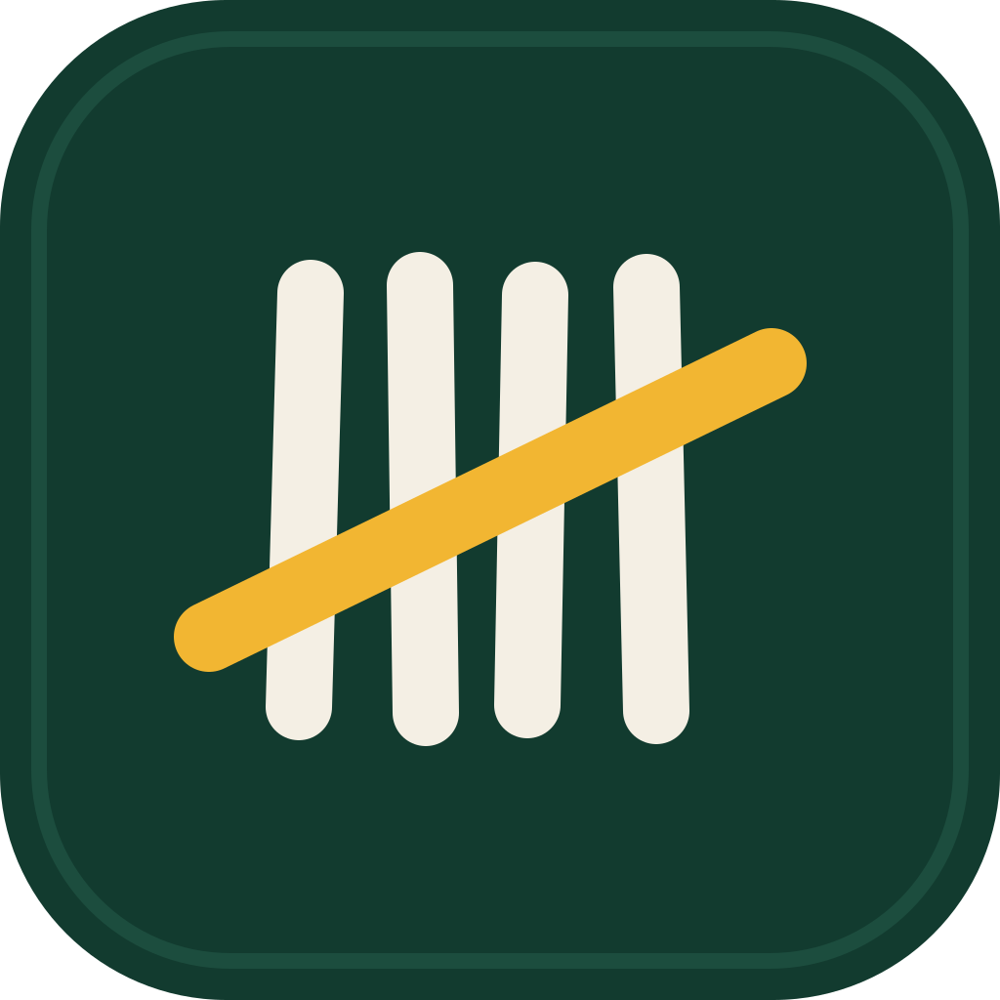

# Scoreboards



App em React Native (Expo + TypeScript) só para marcar placar de jogos de cartas, de mesa e esportes. Leve: sem biblioteca de navegação nem de interface, e as 38 fotos de fundo somam ~600 KB. No Android ele aparece como jogo (`appCategory="game"`).

## Jogos

| Categoria | Jogos |
|---|---|
| Cartas | Truco Paulista, Truco Mineiro, Truco Gaúcho, Cacheta, Pontinho, Pife, Buraco, Tranca, Canastra, Uno, Copas, Fodinha, Sueca, Bisca, Escopa, Rouba-Monte |
| Mesa e bar | Dominó, Sinuca, Bilhar, Pebolim, Dardos, Bocha, Porrinha, Dados, Stop |
| Esportes | Ping-pong, Vôlei, Futevôlei, Beach Tennis, Tênis, Padel, Badminton, Peteca, Futebol, Basquete |
| Outros | Vitórias, Contador, Pontuação livre |

Os alvos (12, 500, 3000...), os pontos iniciais, as vidas e o "melhor de N" podem ser mudados antes de começar.

Cada forma de contar ponto tem a sua tela:

| Tela | Jogos | Como marca |
|---|---|---|
| Tábua de truco | os três trucos | escolhe quanto a mão vale (normal, truco, seis...) e toca no time que ganhou; os pinos sobem na tábua |
| Risquinhos | dominó, porrinha, bilhar, sueca, bisca, vitórias | risquinhos de 5 em 5, com os tipos de ponto do jogo (batida, carroça...) |
| Bloquinho | cartas por rodada, dados, stop, dardos (versão lousa) | uma coluna por jogador, uma linha por rodada e o total embaixo |
| Placar de TV | tênis, beach tennis, padel | sets, games e o ponto (15, 30, 40, vantagem, tie-break, ponto de ouro) |
| Mesa de sinuca | sinuca | escolhe quem está na vez e toca na bola que caiu |
| Tela dividida | ping-pong, vôlei, futevôlei, badminton, peteca, pebolim, bocha, futebol, basquete, contador | toque na cor do time soma, segurar tira |
| Vidas | fodinha | corações por jogador |

Em todos os jogos:

- **Desfazer** sempre visível;
- **Revanche** (mesmos jogadores, placar zerado) e **Mudar jogadores** (volta para a preparação com os mesmos nomes e cores);
- a partida fica salva no aparelho e pode ser retomada pela tela inicial (segurar o cartão descarta);
- a tela não apaga durante a partida e o botão voltar do Android volta para o início.

## Como rodar

Pré-requisitos: Node.js 20 ou superior e o app Expo Go no celular.

```bash
npm install
npx expo start
```

Escaneie o QR code com o Expo Go.

```bash
npm test          # testes das regras de pontuação (node:test, sem dependências)
npm run typecheck
```

## Gerando o APK com Docker

Só precisa do Docker. JDK, Node e Android SDK ficam na imagem (`Dockerfile`), e os passos do build ficam no `docker-compose.yml`.

```bash
docker compose run --rm --build apk
```

O APK sai em `apk/scoreboards.apk`. O primeiro build demora (download do SDK e das dependências do Gradle); os próximos usam o cache.

No Linux, para o arquivo não sair como root:

```bash
HOST_UID=$(id -u) HOST_GID=$(id -g) docker compose run --rm --build apk
```

O build sai só para `arm64-v8a`, que cobre praticamente todo celular atual. Para incluir outras arquiteturas, troque `ANDROID_ARCHS` no `docker-compose.yml` (ex.: `arm64-v8a,armeabi-v7a`) e o `buildArchs` no `app.json`.

Para apagar tudo (imagem, caches e restos do build):

```bash
docker compose down --rmi all -v
docker builder prune -f
```

## Estrutura

```
App.tsx                   providers e escolha da tela
src/engine/               regras puras, sem React (testadas em engine.test.ts)
  types.ts                GameDef, Match, Player
  score.ts                pontos, sets, eliminação e vencedor
  tennis.ts               0-15-30-40, games, tie-break
  match.ts                criar partida, desfazer, revanche
src/games/
  catalog.ts              todos os jogos, um objeto por jogo
  backgrounds.ts          fundo de cada jogo
  describe.ts             frase com a regra da partida
src/state/                salvamento (AsyncStorage) e navegação
src/ui/                   tema e componentes
src/screens/              início, configuração e as 7 telas de placar
assets/bg/                fotos dos jogos em webp (créditos em CREDITS.md)
assets/brand/             logo em svg (os png de ícone e splash saem dele)
assets/textures/          madeira da tábua de truco (gerada, 4 KB)
plugins/                  plugin que marca o app como jogo no android
scripts/optimize-bg.sh    converte fotos para o formato dos fundos
```

Cada jogo tem um `mode` (como o motor conta: `tap`, `rounds`, `lives`, `tennis`) e um `layout` (qual das 7 telas desenha o placar). Jogos parecidos dividem a mesma tela.

## Logo e ícones

O logo são os cinco risquinhos de contagem em giz sobre o feltro. Os PNGs de ícone, ícone adaptativo e splash saem do SVG:

```bash
cd assets/brand
magick -background none -density 192 logo.svg -resize 1024x1024 ../icon.png
magick -background none -density 192 mark.svg -resize 1024x1024 ../adaptive-icon.png
magick -background none -density 96 mark.svg -resize 512x512 ../splash.png
```

## Adicionando um jogo

1. Coloque um objeto novo em `GAMES` no `src/games/catalog.ts` (só os campos que fogem do padrão da função `game`; o `layout` padrão vem do `mode`).
2. Converta a foto de fundo, com o nome do arquivo igual ao `id` do jogo:

   ```bash
   npm run optimize-bg -- pasta/com/a/foto
   ```

   Precisa do ImageMagick 7 (`magick`). A imagem sai em `assets/bg/<id>.webp`, com 480x854 e ~10 a 30 KB.
3. Adicione a linha do `require` em `src/games/backgrounds.ts` e o crédito em `assets/bg/CREDITS.md`.
4. Rode `npm test`: o teste do catálogo confere ids repetidos e regras incoerentes.
